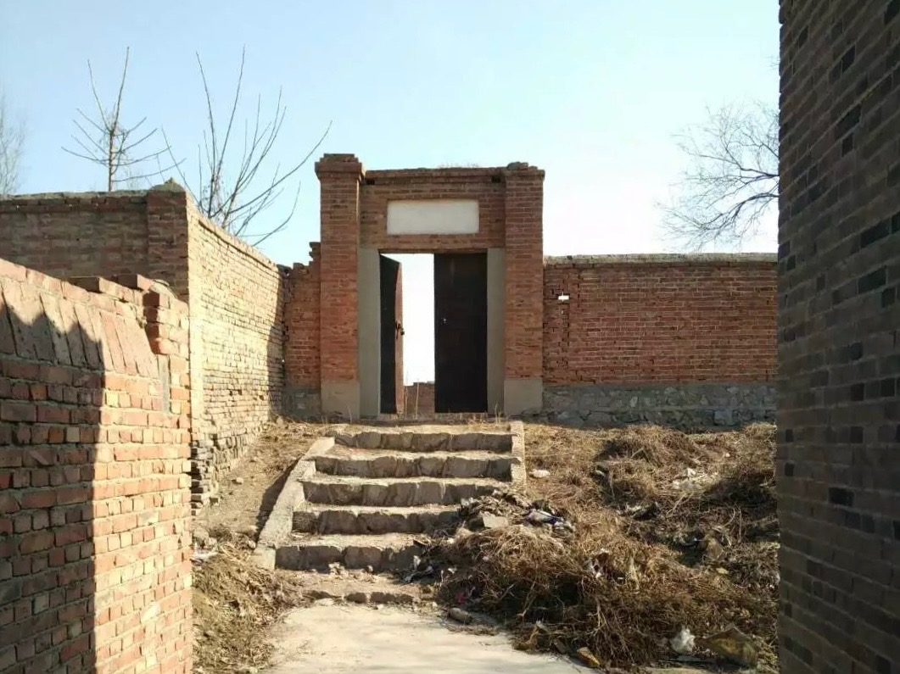
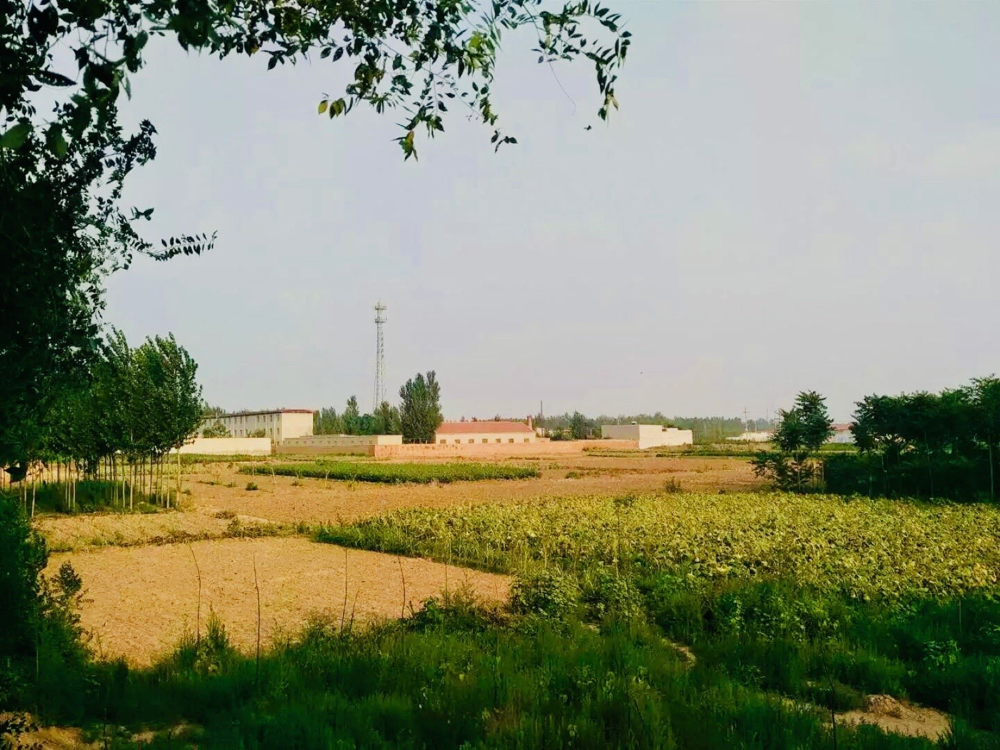
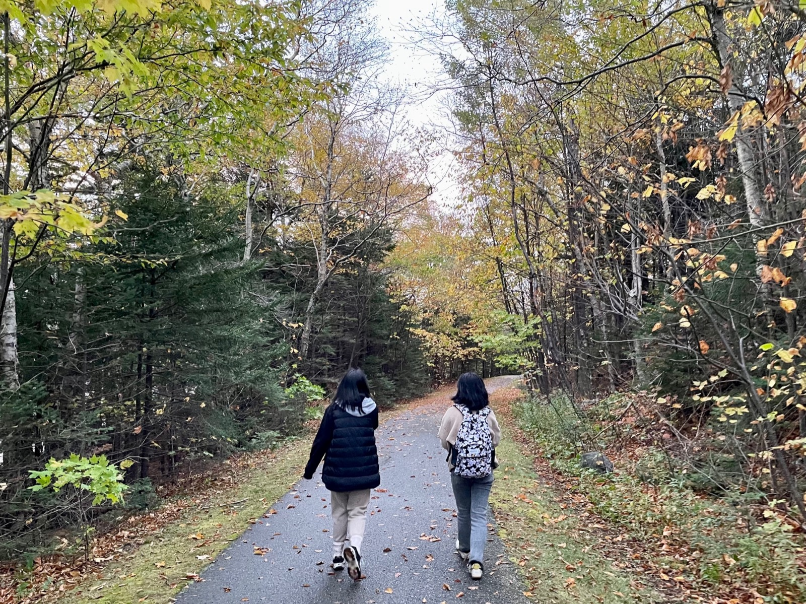
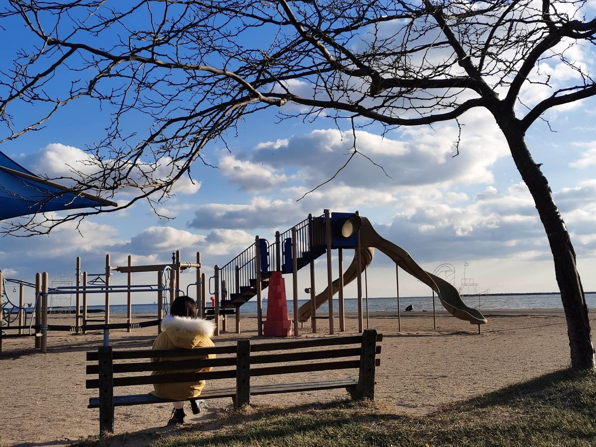

- I grew up in a small village in northern China. I learned my first characters 
with my father writing on the ground with branches, and my first poems with my 
mother before bed. I am lucky to have had a childhood full of simplicity and 
warmth, and to have come this far with the help of many kind people and my own 
courage, determination, and discipline. I will keep going.

    <figure style="display: inline-block; margin: 0; text-align: center;">
        
        <figcaption style="margin-top: 6px; font-family: 'Fredoka One', sans-serif; font-size: 14px; color: #555;">
            Elementary School
        </figcaption>
    </figure>
    <figure style="display: inline-block; margin: 0; text-align: center;">
        
        <figcaption style="margin-top: 6px; font-family: 'Fredoka One', sans-serif; font-size: 14px; color: #555;">
            View in front of home
        </figcaption>
    </figure>

- I am interested in many things outside of science. I enjoy running — sometimes 
it feels like stillness, a chance for my mind to rest. I like reading, watching 
films and documentaries, and knitting while listening to podcasts. I play board 
games with friends and enjoy all kinds of physical activities, including 
badminton, swimming, hiking and rock climbing.

    <figure style="display: inline-block; margin: 0; text-align: center;">
        
        <figcaption style="margin-top: 6px; font-family: 'Fredoka One', sans-serif; font-size: 14px; color: #555;">
            New England
        </figcaption>
    </figure>
    <figure style="display: inline-block; margin: 0; text-align: center;">
        
        <figcaption style="margin-top: 6px; font-family: 'Fredoka One', sans-serif; font-size: 14px; color: #555;">
            East Coast
        </figcaption>
    </figure>

